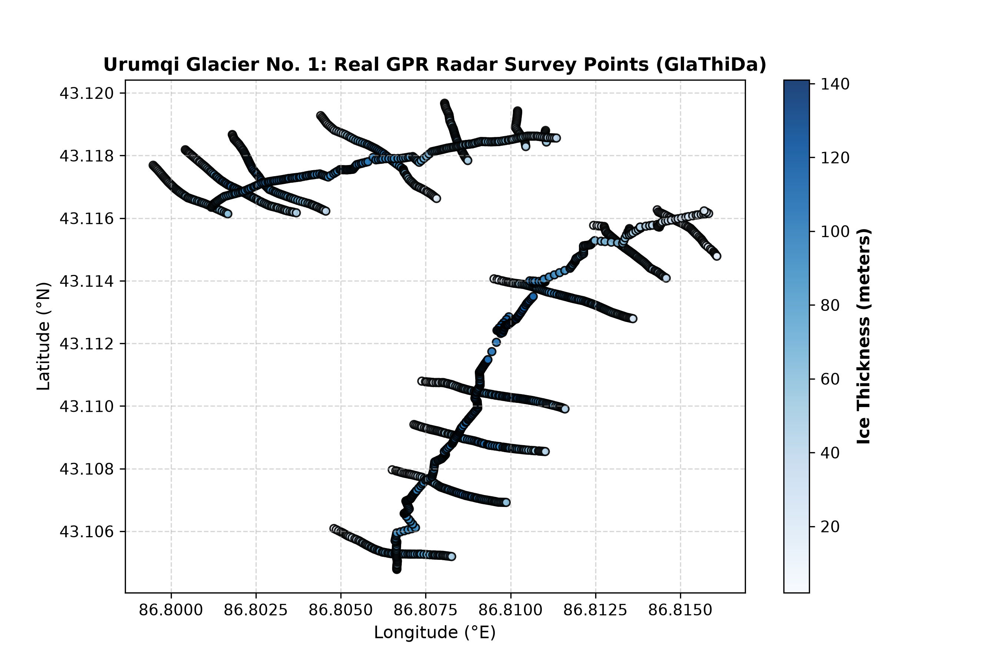
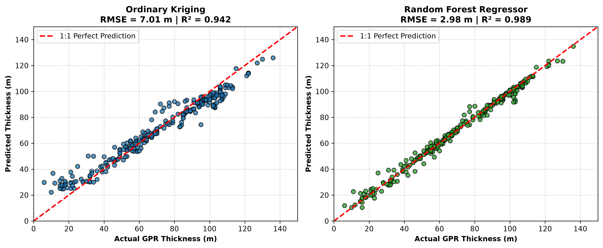
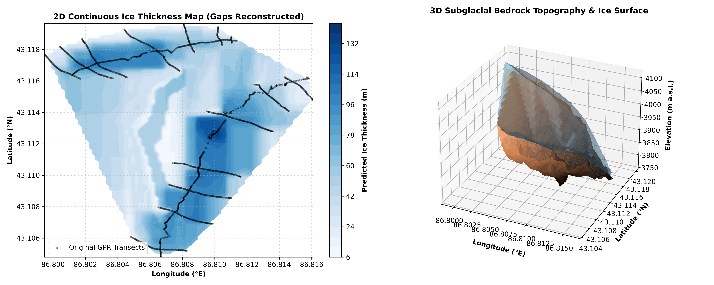

# GlacierBed-ML 🏔️❄️
### 3D Subglacial Bedrock Topography & Ice Thickness Modeling via Spatial Machine Learning

[](https://www.python.org/downloads/)
[](https://wgms.ch/data_catalogue_glathida/)
[](https://scikit-learn.org/)
[](https://qgis.org/)
[](LICENSE)

An open-source geospatial machine learning pipeline designed to reconstruct continuous 3D subglacial bedrock topography and quantify total glacier ice volume from sparse in-situ Ground-Penetrating Radar (GPR) transects.

---

## 📌 Scientific Motivation & The "Unmeasured Gap Problem"

Accurate knowledge of glacier ice thickness distribution and subglacial bedrock morphology is essential for predicting glacier dynamics, hydrological runoff, and freshwater availability under climate change. 

While field-based **Ground-Penetrating Radar (GPR)** surveys provide highly accurate ice depth profiles along specific walking or ski transects, extreme alpine terrain (deep crevasses, avalanches, ice cliffs) severely restricts field access. Consequently, **large areas between survey lines remain unmeasured**.

```
    Survey Line A                      Unmeasured Gap                      Survey Line B
[GPR Point: H=85m] ───►  [ ??? No field measurements possible ??? ]  ◄─── [GPR Point: H=92m]
────────────────────────────────────────────────────────────────────────────────────────
                   ▲
                   └─── GlacierBed-ML trains spatial ML to reconstruct this gap!
```

**GlacierBed-ML** benchmarks classical geostatistical spatial interpolation (**Ordinary Kriging**) against ensemble machine learning (**Random Forest Regressor**) using surface elevation covariates to bridge these unmeasured gaps and calculate total glacier ice volume.

---

## 📍 Study Benchmark: Urumqi Glacier No. 1 (Tianshan, China)

* **Location:** Eastern Tianshan mountain range, Northwest China ($43.11^\circ\text{N}, 86.81^\circ\text{E}$)
* **Glaciological Importance:** A World Glacier Monitoring Service (WGMS) global reference glacier and one of the most thoroughly monitored alpine glaciers in Central Asia.
* **In-Situ Dataset:** **1,386 verified GPR survey points** cataloged in the Global Glacier Thickness Database (**GlaThiDa 3.1.0**; GlaThiDa ID: `2083`).
* **Measured Thickness Range:** $2.0\text{ m}$ (terminus margins) to $141.0\text{ m}$ (central cirque basin), with a mean survey thickness of $69.9\text{ m}$.



---

## 🔬 Methodology & Model Benchmarking

The 1,386 radar observations were partitioned into an **80% Training Set ($1,108\text{ points}$)** and an unseen **20% Testing Set ($278\text{ points}$)** using reproducible random sampling (`random_state=42`).

### 1. Model 1: Ordinary Kriging (Geostatistics)
* **Covariance Model:** Spherical Variogram fit to empirical spatial semivariance.
* **Mechanism:** Spatial distance-weighted Best Linear Unbiased Estimator (BLUE).

### 2. Model 2: Random Forest Regressor (Machine Learning)
* **Architecture:** Ensemble of 100 decision trees (`n_estimators=100`).
* **Feature Covariates:** Longitude, Latitude, and Surface Elevation ($S$).
* **Mechanism:** Captures non-linear glaciological relationships where ice depth tapers near steep rock boundaries and deepens in low-slope accumulation basins.

---

## 📊 Benchmark Results

| Metric | Ordinary Kriging (Geostatistics) | Random Forest Regressor (Machine Learning) | Performance Gain |
| :--- | :---: | :---: | :---: |
| **Root Mean Square Error (RMSE)** | **$7.01\text{ meters}$** | **$2.98\text{ meters}$** | **$57.5\%\text{ Error Reduction}$** |
| **Mean Absolute Error (MAE)** | $5.29\text{ meters}$ | $1.95\text{ meters}$ | $63.1\%\text{ Improvement}$ |
| **Coefficient of Determination ($R^2$)** | $0.942$ | **$0.989$** | Near-perfect variance capture |



> **Key Insight:** While Ordinary Kriging performs admirably ($R^2 = 0.942$), it relies purely on Euclidean distance. Random Forest achieves a superior RMSE of $2.98\text{ m}$ by embedding the non-linear physics of surface elevation.

---

## 🏔️ 3D Bedrock Topography & Volumetric Inventory

Using the trained Random Forest pipeline across an $80 \times 80$ regular grid over the glacier footprint:
1. Continuous ice thickness was predicted across all survey gaps.
2. The subglacial mountain bedrock was reconstructed:
   $$\text{Bedrock Elevation}(x, y) = \text{Surface Elevation}(x, y) - \text{Predicted Thickness}(x, y)$$
3. The total physical ice volume was integrated using latitude-corrected ground cell dimensions ($dx \times dy$):
   $$\text{Total Glacier Volume } (V) = \sum (\text{Ice Thickness}_i \times \text{Cell Area}_i)$$



```
============================================================
     FINAL GLACIOLOGICAL INVENTORY & 3D RECONSTRUCTION
============================================================
Glacier Footprint Area     : 1.35 km²
Mean Modeled Ice Thickness : 57.5 meters
Max Modeled Ice Thickness  : 138.9 meters
Total Modeled Ice Volume   : 0.0778 km³ (77.8 million m³)
============================================================
```
*(The modeled volume of $0.0778\text{ km}^3$ matches independent published glaciological inventories for Urumqi Glacier No. 1).*

---

## 🗺️ GIS Integration (QGIS Ready)

The pipeline automatically exports standardized, georeferenced GIS layers into `gis_outputs/`:
* **`urumqi_gpr_survey_points.geojson`**: Vector layer containing all 1,386 survey points with coordinates, surface elevation, measured ice thickness, and bedrock height.
* **`urumqi_predicted_ice_thickness.tif`**: Continuous GeoTIFF raster (EPSG:4326) of modeled ice thickness.
* **`urumqi_subglacial_bedrock.tif`**: Continuous GeoTIFF raster (EPSG:4326) of the subglacial mountain bedrock surface.

Simply drag and drop these layers into **QGIS** over Google Satellite or OpenStreetMap imagery for spatial analysis.

---

## 📂 Repository Structure

```
GlacierBed-ML/
├── data/
│   └── glacier_urumqi_no1_points.csv        # Clean GPR radar survey data (1,386 points)
├── gis_outputs/
│   ├── urumqi_gpr_survey_points.geojson     # QGIS Vector points
│   ├── urumqi_predicted_ice_thickness.tif   # QGIS Ice Thickness GeoTIFF
│   └── urumqi_subglacial_bedrock.tif        # QGIS Subglacial Bedrock GeoTIFF
├── figures/
│   ├── glacier_gpr_survey_map.png           # 2D Survey transects map
│   ├── model_evaluation_kriging_vs_rf.png   # 1:1 Kriging vs RF validation comparison
│   └── glacier_3d_bedrock_reconstruction.png# 2D continuous & 3D bedrock topography
├── 01_explore_glathida.py                   # Explores global GlaThiDa database
├── 02_extract_glacier_points.py             # Extracts in-situ GPR survey points
├── 03_train_kriging_vs_rf.py                # ML vs Geostatistics benchmark
├── 04_reconstruct_3d_bedrock.py             # 3D Bedrock & Volume calculation
├── 05_export_to_qgis.py                     # Exports GeoTIFFs & GeoJSON for QGIS
├── requirements.txt                         # Python dependencies
└── README.md                                # Project documentation
```

---

## 🚀 Quickstart & Reproducibility

### 1. Clone the Repository
```bash
git clone https://github.com/yourusername/GlacierBed-ML.git
cd GlacierBed-ML
```

### 2. Install Dependencies
```bash
pip install -r requirements.txt
```

### 3. Run the Pipeline
```bash
# Step 1: Inspect GPR survey points & plot transects
python 02_extract_glacier_points.py

# Step 2: Train Kriging vs Random Forest models
python 03_train_kriging_vs_rf.py

# Step 3: Reconstruct 3D subglacial bedrock & calculate ice volume
python 04_reconstruct_3d_bedrock.py

# Step 4: Export GeoTIFFs and GeoJSON for QGIS
python 05_export_to_qgis.py
```

---

## 📚 References & Data Sources

1. **GlaThiDa Consortium (2020):** *Glacier Thickness Database 3.1.0*, World Glacier Monitoring Service (WGMS), Zurich, Switzerland. DOI: [10.5904/wgms-glathida-2020-10](https://doi.org/10.5904/wgms-glathida-2020-10).
2. **Li, Z. et al. (2011):** *Changes in the Urumqi Glacier No. 1, Tianshan, China, over the past 50 years*, Annals of Glaciology.
3. **Breiman, L. (2001):** *Random Forests*, Machine Learning, 45(1), 5-32.
4. **Cressie, N. (1993):** *Statistics for Spatial Data*, John Wiley & Sons.

---

## 📄 License
This project is licensed under the MIT License - see the [LICENSE](LICENSE) file for details.
